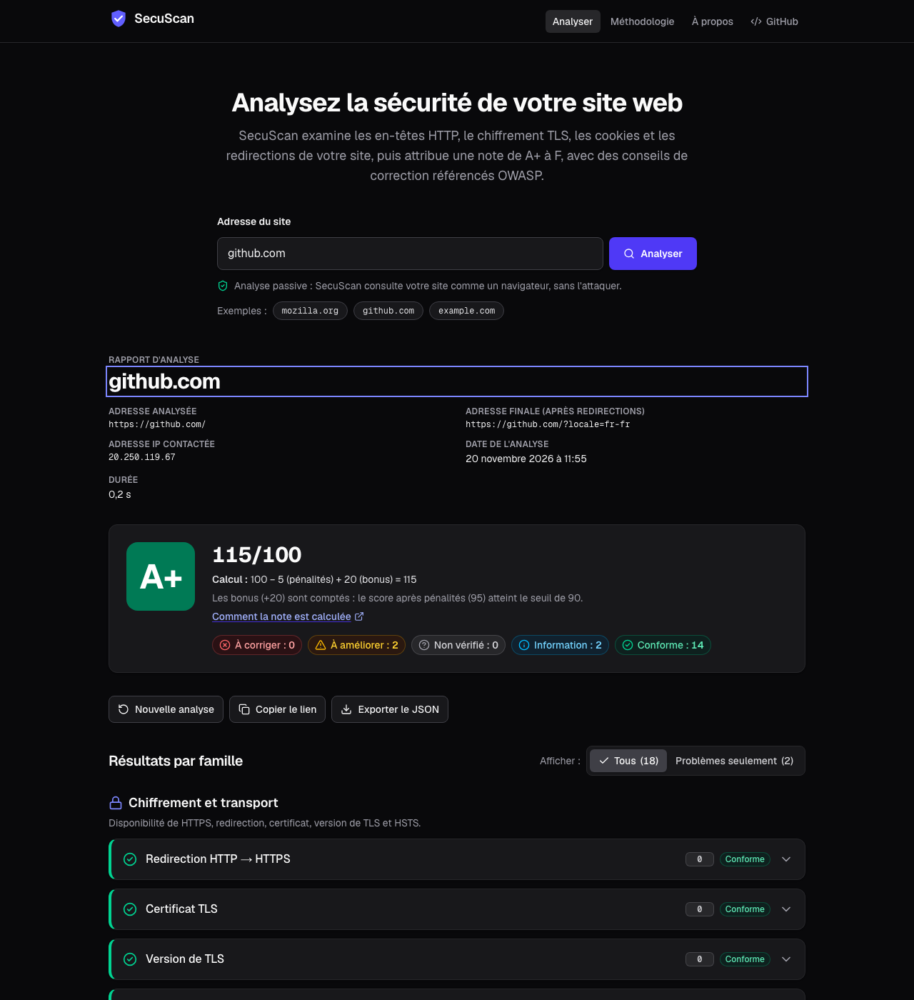

# SecuScan

[](https://github.com/kyky709/SecuScan/actions/workflows/ci.yml)
[](LICENSE)


SecuScan analyse la configuration de sécurité d'un site web. Vous lui donnez une adresse, il vérifie
18 points (HTTPS, certificat, en-têtes de sécurité, cookies, contenu mixte…), met une note de A+ à F
et explique, pour chaque problème, pourquoi c'est un risque et comment le corriger.

C'est un projet perso. La sécurité web m'intéresse, et je voulais comprendre ce que vérifient
vraiment des outils comme [MDN HTTP Observatory](https://developer.mozilla.org/en-US/observatory) ou
[securityheaders.com](https://securityheaders.com). Le meilleur moyen, c'était d'en écrire un.

**Essayer : [secuscan-gamma.vercel.app](https://secuscan-gamma.vercel.app)**



## Comment ça marche, en simple

Quand votre navigateur charge une page, le serveur ne renvoie pas seulement du HTML. Il glisse aussi
des consignes dans les en-têtes de la réponse : « ne me contacte plus jamais en clair » (HSTS),
« n'exécute que les scripts qui viennent de chez moi » (CSP), « ne m'affiche pas dans le cadre d'un
autre site » (protection contre le clickjacking)… Bien réglées, ces consignes bloquent des familles
d'attaques entières. Oubliées, elles laissent la porte ouverte, et rien ne se voit à l'écran.

SecuScan fait le même chemin qu'un navigateur, mais en regardant tout ça de près :

1. **Il vérifie l'adresse.** Avant de contacter quoi que ce soit, il s'assure qu'elle mène à un site
   public, et pas à une machine interne (voir plus bas pourquoi c'est important).
2. **Il visite le site**, en lecture seule : la page en HTTPS, la version HTTP (redirige-t-elle ?),
   la connexion chiffrée elle-même (certificat, version de TLS), le fichier `security.txt`, une
   requête CORS et une interrogation DNS. Ces six vérifications partent en parallèle.
3. **Il compare ce qu'il a vu aux bonnes pratiques.** Chacun des 18 contrôles lit les informations
   récoltées et rend un verdict : conforme, à améliorer ou à corriger.
4. **Il calcule une note.** On part de 100 ; chaque problème retire des points, et les bonnes
   pratiques avancées en rapportent, mais seulement si le site est déjà solide. C'est le barème de
   MDN Observatory, ce qui permet de comparer : sur github.com, mozilla.org ou owasp.org, les deux
   outils donnent le même score.
5. **Il explique.** Pour chaque point : ce qui a été observé, le risque, la correction avec des
   exemples prêts à copier (Nginx, Apache, Next.js) et les références OWASP et MDN.

Rien n'est enregistré : le rapport est calculé, envoyé au navigateur, puis oublié.

## Ce qui est vérifié

| Famille | Contrôles |
|---|---|
| Chiffrement et transport | Redirection HTTP vers HTTPS, certificat, version de TLS, HSTS |
| En-têtes de sécurité | CSP, clickjacking, X-Content-Type-Options, Referrer-Policy, Permissions-Policy, isolation entre origines (COOP, COEP, CORP), X-XSS-Protection |
| Cookies | Attributs `Secure`, `HttpOnly`, `SameSite` et préfixes `__Host-` / `__Secure-` |
| Contenu et ressources | Intégrité des scripts tiers (SRI), contenu mixte, CORS |
| Exposition | Versions de logiciels divulguées, fichier `security.txt`, enregistrements DNS CAA |

Le détail de chaque règle et du barème est sur la page
[Méthodologie](https://secuscan-gamma.vercel.app/methodologie) du site.

## Un scanner, c'est aussi une cible

Le serveur de SecuScan contacte des adresses tapées par n'importe qui. Sans précaution, quelqu'un
pourrait lui demander d'analyser `http://192.168.1.1` ou l'adresse interne de l'hébergeur, et s'en
servir pour explorer un réseau auquel il n'a pas accès. C'est ce qu'on appelle une attaque SSRF.

- Chaque adresse est vérifiée **au moment même de la connexion**, et pas seulement au début : un
  nom de domaine peut changer de réponse entre la vérification et la connexion (DNS rebinding).
- Chaque redirection est revérifiée. Seuls les ports 80 et 443 sont autorisés, et les adresses
  privées, réservées ou déguisées (IPv4 cachée dans une IPv6) sont refusées.
- J'ai essayé plus de 40 façons de contourner ces protections. Aucune n'a abouti, et elles sont
  toutes rejouées dans les tests.

Autres protections : limite du nombre d'analyses par minute, délais et tailles de réponse bornés,
CSP stricte sur l'application elle-même.

En testant mon propre code, j'ai aussi trouvé une faille ReDoS : une page piégée pouvait occuper le
serveur 13 secondes à cause d'expressions régulières mal écrites. Les analyseurs sont maintenant
linéaires (2 ms sur la même page), et un test empêche la faille de revenir.

## Lancer le projet

Il faut Node.js 24 (voir `.nvmrc`).

```bash
git clone https://github.com/kyky709/SecuScan.git
cd SecuScan
npm ci
npm run dev          # http://localhost:3000
```

| Commande | Rôle |
|---|---|
| `npm run dev` | Serveur de développement |
| `npm run build` puis `npm start` | Version de production |
| `npm test` | Tests (Vitest) |
| `npm run test:coverage` | Tests avec couverture |
| `npm run check` | Types, lint et tests, à lancer avant chaque commit |
| `npm run lint:fix` | Formatage et tri des imports (Biome) |

Aucune variable d'environnement n'est obligatoire ; elles sont décrites dans
[`.env.example`](.env.example).

## API

L'analyse est aussi disponible en JSON, sans passer par l'interface :

```bash
curl -s -X POST https://secuscan-gamma.vercel.app/api/scan \
  -H "Content-Type: application/json" \
  -d '{"url": "example.com"}'
```

La réponse est un `ScanReport` (défini dans `src/lib/scanner/types.ts`) :

```json
{
  "schemaVersion": 1,
  "target": { "url": "https://example.com/", "hostname": "example.com", "finalUrl": "https://example.com/" },
  "score": { "base": 100, "penalties": -110, "bonuses": 0, "bonusesApplied": false, "score": 0, "grade": "F" },
  "summary": { "pass": 5, "warning": 2, "fail": 5, "info": 6, "error": 0 },
  "checks": [
    {
      "id": "hsts",
      "status": "fail",
      "scoreModifier": -20,
      "summary": "L'en-tête Strict-Transport-Security est absent de la réponse HTTPS.",
      "recommendation": "…",
      "examples": [{ "label": "Nginx", "language": "nginx", "code": "…" }],
      "references": [{ "kind": "owasp-cheatsheet", "label": "OWASP – HTTP Strict Transport Security Cheat Sheet", "url": "…" }]
    }
  ]
}
```

En cas d'erreur : `{ "error": { "code": "TARGET_NOT_ALLOWED", "message": "…" } }` avec le statut
HTTP qui correspond (400, 403, 413, 422, 429, 502 ou 504). Limites : 10 analyses par minute par
client et 6 par minute pour un même site.

## Sous le capot

L'idée qui structure le code : **on récolte les faits une seule fois, puis on les juge**. Les sondes
réseau visitent le site et rangent tout ce qu'elles voient dans un objet `ScanContext`. Les 18
contrôles sont ensuite de simples fonctions qui lisent cet objet et rendent un verdict, sans jamais
toucher au réseau. Résultat : ils se testent en quelques millisecondes avec des données fabriquées à
la main.

```
saisie ─► vérification de l'adresse ─► 6 sondes réseau ─► ScanContext ─► 18 contrôles ─► note ─► rapport
```

| Couche | Technologies |
|---|---|
| Application | Next.js 16 (App Router), React 19, TypeScript strict |
| Interface | Tailwind CSS 4, lucide-react |
| Moteur | Modules `http`, `https`, `tls` et `dns` de Node.js, ipaddr.js, node-html-parser |
| Validation | zod |
| Limitation de débit | En mémoire, ou Upstash Redis |
| Qualité | Biome, Vitest, Testing Library, GitHub Actions, CodeQL, Dependabot |
| Hébergement | Vercel (région Paris) |

Environ 1 600 tests, qui tournent sans accès à Internet : de vrais petits serveurs HTTP et TLS sont
lancés en local pour tester la partie réseau. Le moteur est couvert à 98 %. La CI bloque si les
types, le lint, les tests ou le build échouent.

## Utilisation responsable

N'analysez que des sites qui vous appartiennent ou que vous avez le droit d'évaluer. SecuScan se
contente de lire ce que n'importe quel navigateur reçoit : il ne cherche pas de failles et n'explore
pas le site. Ses requêtes s'identifient par leur User-Agent, et le nombre d'analyses par site est
limité.

## Licence

[MIT](LICENSE)
